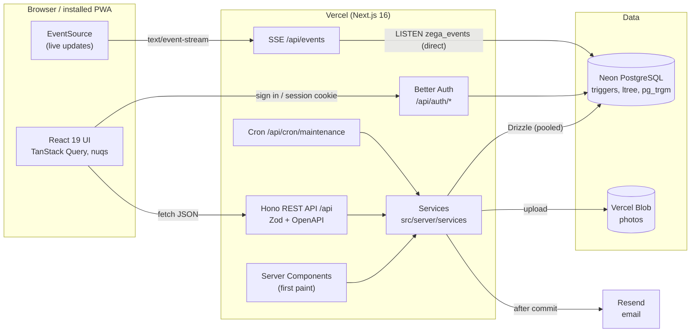
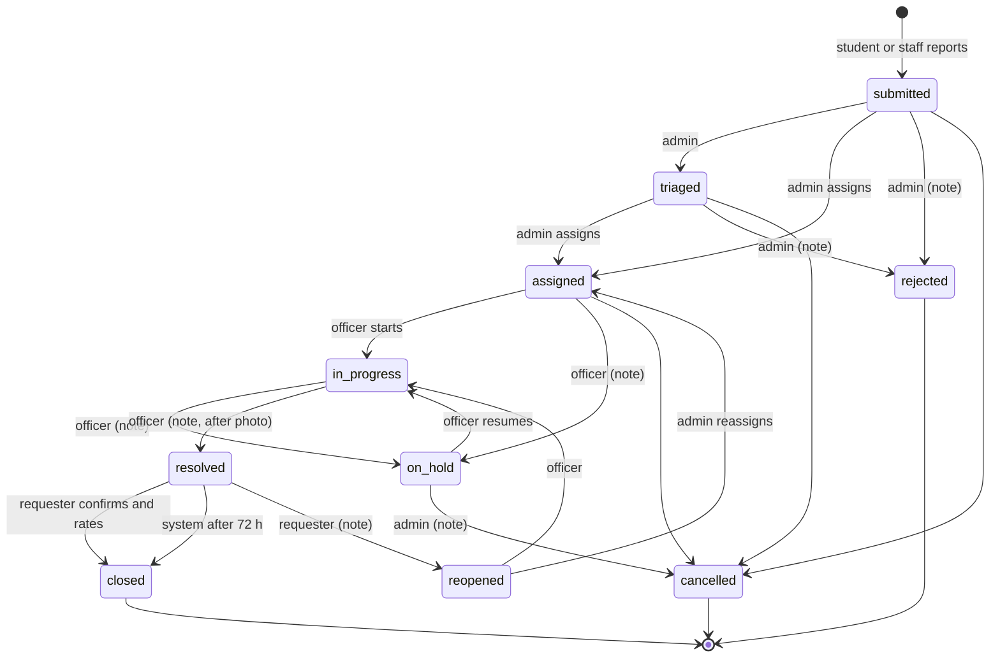

# Architecture

ZEGA is one Next.js application that serves the web interface and a REST API, backed by a single
PostgreSQL database. There are no separate services to run.

## System overview

## Layers

| Layer | Location | Responsibility |
| --- | --- | --- |
| Routes and screens | `src/app` | Pages per role. Server Components load the first view through the services; Client Components handle interaction. |
| API | `src/server/api` | Hono app: request id, authentication, validation, RBAC guards, Problem Details errors, OpenAPI document. |
| Services | `src/server/services` | Business operations (create, transition, assign, report, audit). Used by the API and by Server Components, so both paths share the same rules. |
| Domain | `src/domain` | Pure rules with no I/O: the request state machine, SLA calculations, role permissions. Shared by server and browser. |
| Data | `src/server/db`, `drizzle/` | Drizzle schema, SQL migrations, triggers, seed. |
| Realtime | `src/server/realtime` | Event bus over Postgres `LISTEN/NOTIFY` and per-user SSE fan-out. |

The API depends on interfaces (`db`, `authenticate`, `storage`, `events`) injected in
`createApi()`. Production passes Neon, Better Auth, Vercel Blob and the Postgres listener; tests pass
PGlite, a header-based authenticator, in-memory storage and an in-process bus. Everything between
those edges is the same code.

## Request lifecycle

The state machine in `src/domain/request-machine.ts` is the single source of truth. The API rejects
any other transition with `409 Conflict`, and the UI renders only the actions it allows.

Each transition writes a `status_logs` row in the same transaction as the status change. A trigger
on `status_logs` then publishes a `NOTIFY`, and the audit trigger records the change.

## A request through the system

1. **Report.** The wizard posts `POST /api/requests`. The service checks the category and location,
   looks up the SLA policy for the category and priority, computes due dates and inserts the request
   and its first status log inside `withActor()`, which sets `app.user_id` so the audit trigger knows
   who acted.
2. **Notify.** Notifications for admins are inserted in the same transaction. Emails are queued with
   `afterCommit()` and only sent if the transaction commits.
3. **Live update.** The `notifications` and `status_logs` triggers call `pg_notify('zega_events', …)`.
   The SSE endpoint holds one `LISTEN` connection per server instance and forwards each event to the
   users allowed to see it. The browser invalidates the matching TanStack Query caches.
4. **Assign.** The admin opens the request; `GET /api/requests/{id}/suggestions` ranks officers by
   specialty and current open workload. Assigning closes the previous assignment row and opens a new
   one, so the full history is kept.
5. **Work.** The officer drags the card on the board (or uses the Move menu). Each move is a
   `POST /api/requests/{id}/transitions` checked against the state machine.
6. **Close.** The requester confirms and rates, or reopens with a note. Unconfirmed fixes close
   automatically after 72 hours.

## Security

| Concern | Measure |
| --- | --- |
| Passwords | scrypt via Better Auth; minimum length and letter + digit rule enforced by Zod |
| Sessions | Database sessions in httpOnly, SameSite cookies; 7 days, refreshed daily; list and revoke devices; role change or deactivation ends all sessions |
| API clients | Short-lived EdDSA JWT (`GET /api/auth/token`), keys at `/api/auth/jwks` |
| Authorisation | Route guards check permissions from `src/domain/permissions.ts`; services re-check ownership (requesters see their own requests, officers their assigned ones). Hidden requests return `404`, not `403`. |
| Abuse | Better Auth rate limiting stored in the database; upload size and count limits; byte sniffing of image types |
| Input | Zod validation on every route; field errors returned as Problem Details `errors[]` |
| Headers | Content Security Policy (stricter for the app, relaxed only for `/api/docs`), `X-Frame-Options: DENY`, `nosniff`, referrer and permissions policies |
| Accountability | Hash-chained audit trail that cannot be updated, deleted or truncated (triggers enforce it) |
| Privacy | EXIF stripped in the browser before upload; retention purge for read notifications and expired sessions; see `/privacy` |

## Observability

`src/server/log.ts` writes one JSON object per line (`time`, `level`, `event`, ids). Events include
`api.unhandled`, `auth.forbidden`, `auth.unauthenticated`, `user.role_changed`,
`user.deactivated`, `user.sessions_revoked`, `maintenance.completed` and `events.connection_lost`.
Security events carry `security: true`. Every API response has an `X-Request-Id` header that also
appears in the logs and in Problem Details bodies, so a user's error report can be traced.

`GET /api/health` checks the database and reports latency and the deployed commit.

## Background work

There is no queue or worker. The maintenance sweep (`runMaintenance`) escalates SLA breaches,
auto-closes old resolutions and purges expired data. It is triggered by the daily Vercel Cron and,
at most every five minutes, by active live-update connections. A row in `system_jobs` is claimed
atomically, so concurrent triggers never run it twice. See
[ADR 0007](decisions/0007-opportunistic-scheduler.md).
