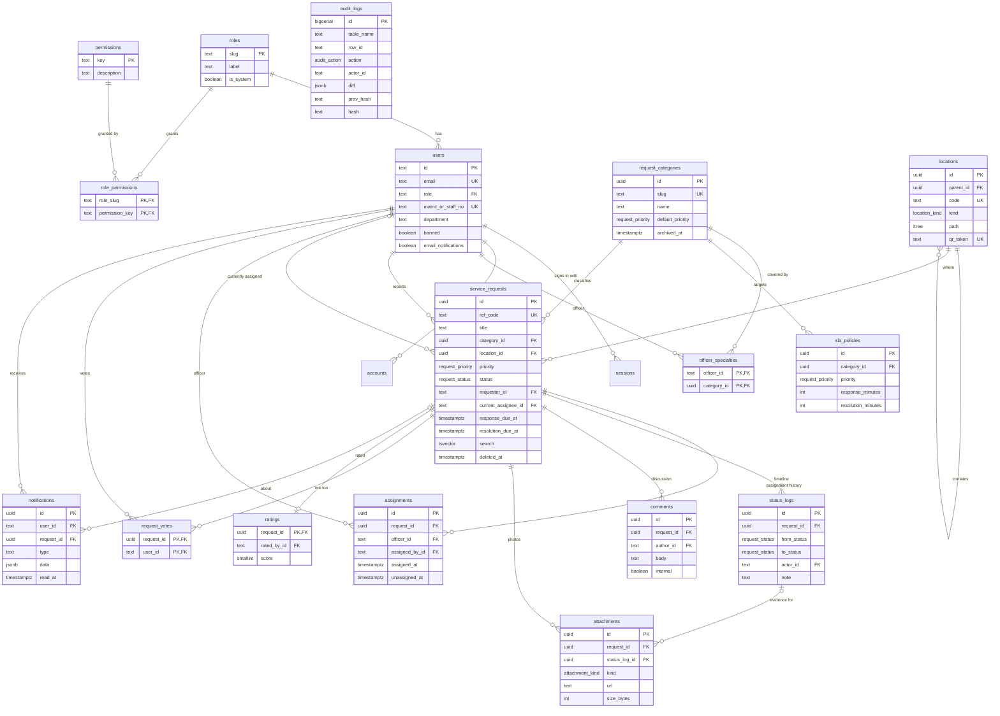

# Database

PostgreSQL on Neon, accessed through Drizzle ORM. The schema lives in `src/server/db/schema`;
SQL that Drizzle cannot express (extensions, triggers, functions) lives in hand-written migrations in
`drizzle/`.

## Entity relationship diagram

Better Auth also owns `verifications`, `jwks` and `rate_limits`; `system_jobs` records the last run
of background jobs.

## The six core entities

| Entity | Table | Notes |
| --- | --- | --- |
| Users | `users` | Better Auth's user table, extended with role, department, matric/staff number and preferences |
| Roles | `roles` (+ `permissions`, `role_permissions`) | Four system roles: student, staff, officer, admin |
| Requests | `service_requests` | Human reference `ZG-YY-NNNNNN` from a sequence; soft delete |
| Categories | `request_categories` (+ `sla_policies`) | Archiving hides a category from the form without touching history |
| Assignments | `assignments` | One row per assignment period; `unassigned_at` closes it on reassignment |
| Status logs | `status_logs` | Every status change with actor and note; the request timeline |

## Relationship types

| Type | Example |
| --- | --- |
| One to one | `service_requests` to `ratings` (the rating's primary key is the request id) |
| One to many | a user reports many requests; a request has many status logs, comments and photos |
| Many to many | roles and permissions (`role_permissions`); officers and categories (`officer_specialties`); users voting on requests (`request_votes`) |
| Self-referencing | `locations.parent_id` builds Campus, Building or Hostel, Floor, Room |
| History | `assignments` and `status_logs` keep every past state instead of overwriting |

## Postgres features in use

- **Enums** for status, priority, attachment kind, location kind and audit action.
- **`ltree`** on `locations.path`, maintained by triggers when a location is inserted or moved
  (including its whole subtree). "Everything in Amina Hall" is one indexed `path <@ 'amina'` query
  (GiST index).
- **Full-text search**: `service_requests.search` is a generated `tsvector` over title and
  description with a GIN index.
- **Trigram similarity** (`pg_trgm`) on titles powers duplicate detection while reporting.
- **Keyset pagination** over `(created_at desc, id desc)` with a matching index; the cursor is opaque.
- **Check constraints**, for example the rating score between 1 and 5.
- **`LISTEN/NOTIFY`** triggers on `status_logs` and `notifications` drive live updates.

## Audit trail

A generic trigger function (`zega_audit_row`) is attached to every business table. For each insert, update or
delete it writes an `audit_logs` row with the table, row id, action, the acting user (read from the
transaction setting `app.user_id`, set by `withActor()`) and a JSON diff of changed columns.

Before insert, `zega_audit_chain` takes an advisory lock, assigns the id, and stores
`hash = sha256(prev_hash | digest(row))`, so every entry depends on all entries before it. Further
triggers reject `UPDATE`, `DELETE` and `TRUNCATE` on `audit_logs`. `GET /api/audit/verify`
calls the SQL function `audit_verify_chain()`, which recomputes the chain and reports the first
broken link, if any.

Migration `0004` fixed a race where two concurrent writers could take ids in one order and the lock
in the other; the id is now assigned while holding the lock. See
[ADR 0004](decisions/0004-hash-chained-audit-trail.md).

## Indexes

Besides primary keys and unique constraints: requests by status, requester, assignee, category,
location and creation order; GIN on the search vector and on title trigrams; GiST on location paths;
sessions, accounts and notifications by user; audit logs by row and by actor.

## Migrations

| File | Contents |
| --- | --- |
| `0000_extensions.sql` | `pgcrypto`, `ltree`, `pg_trgm` |
| `0001_schema.sql` | Tables, enums, indexes and the reference code sequence (generated by `drizzle-kit`) |
| `0002_triggers.sql` | Location path triggers, audit trigger and hash chain, `NOTIFY` triggers |
| `0003_audit_truncate_guard.sql` | Blocks `TRUNCATE` on the audit table |
| `0004_audit_chain_ordering.sql` | Assigns audit ids under the chain lock (race fix) |
| `0005_notifications_and_jobs.sql` | `system_jobs` table, email preference and SLA escalation columns |

Workflow: change the schema in TypeScript, run `npm run db:generate`, review the SQL, then
`npm run db:migrate`. Migrations are forward-only and run automatically before every Vercel build.
Applied migrations are skipped.

## Environments and backups

There is one shared Neon database for development and production (a deliberate trade-off for a
course project with demo data; see [ADR 0006](decisions/0006-vercel-and-single-neon-database.md)).
Tests never touch it: they run against an in-process PGlite database built from the same
migrations.

Backups rely on Neon's point-in-time restore: the free plan keeps a short history window (restore
any moment within it into a new branch from the Neon console). For a production deployment the
next steps would be a separate production branch, a longer retention window and a scheduled
`pg_dump` to object storage.

## Data retention

The maintenance sweep deletes read notifications older than 180 days and expired sessions and
verification tokens. Requests, their history and the audit trail are kept as the institution's
record.
