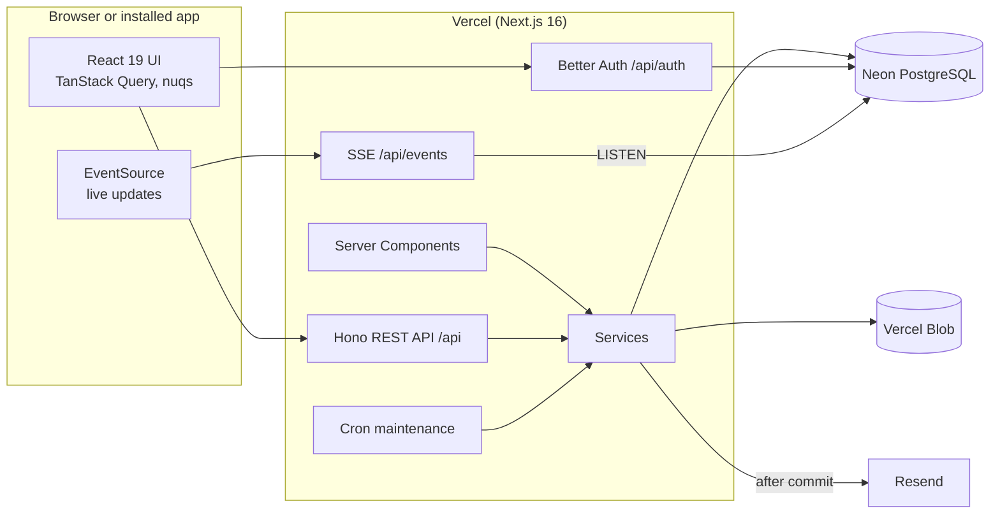
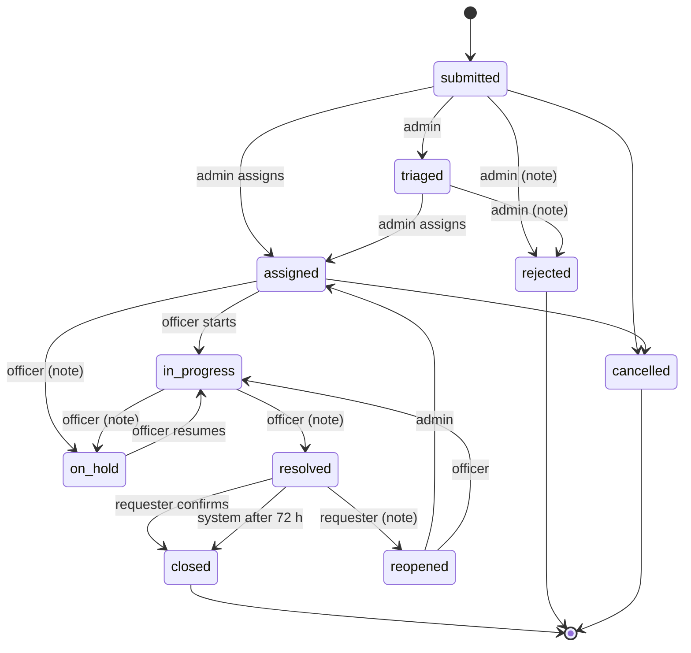
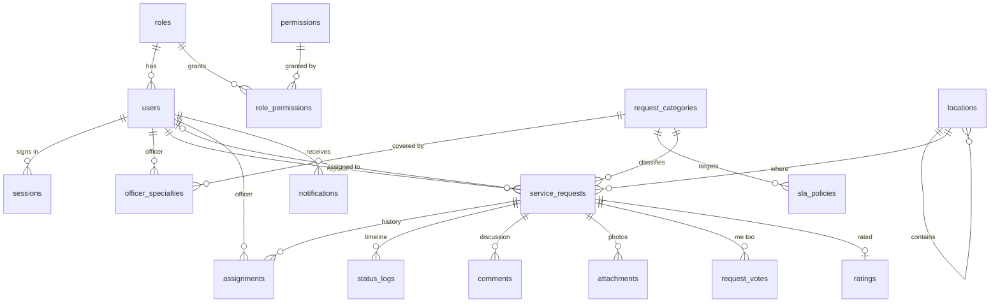
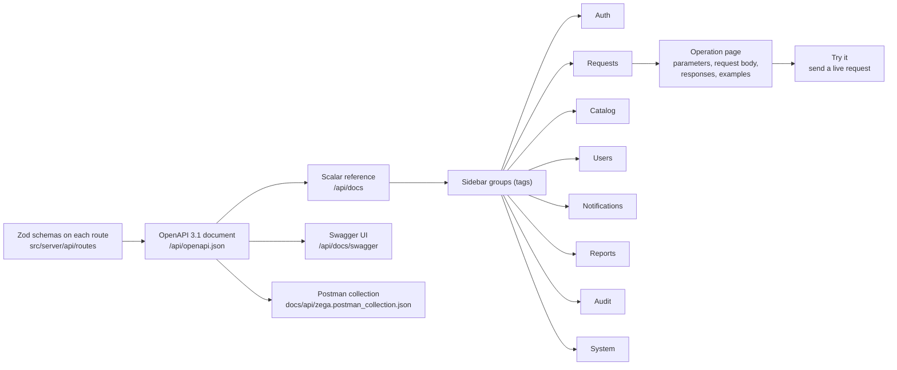
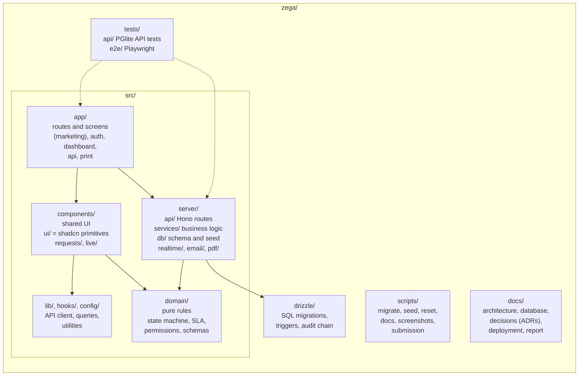

# 1. Introduction and problem statement

The university receives maintenance complaints and service requests through phone calls, paper
forms, WhatsApp messages and office visits. Each channel loses information in its own way: a phone
call leaves no record, a paper form can be misplaced, a WhatsApp message scrolls out of view and an
office visit depends on who happens to be at the desk. The result is the set of problems named in
the brief: delays, missing records, poor tracking and no accountability. Nobody can say how many
faults are open, how long they have been open, who is working on them or whether they were ever
fixed.

**ZEGA** ("Report it. Track it. Resolve it.") replaces these channels with one web platform. Students
and staff report a fault in under a minute, optionally by scanning a QR sticker in the room. The
request is routed to an administrator, assigned to a maintenance officer with the right skills and
followed through every status change until the requester confirms the fix. Every action is stored
with who did it and when, in an audit trail that cannot be edited.

ZEGA is live at **<https://zega-ms.vercel.app>** with seeded demonstration data and four demo
accounts (section 10).

# 2. System objectives

1. **One accountable channel.** Every request gets a human reference (for example `ZG-26-000122`),
   an owner, a status and a full history. Nothing is lost between a report and a repair.
2. **Fast, guided reporting.** A four-step form with category cards, a location picker or QR scan,
   photo evidence and duplicate detection, so requesters give officers what they need the first time.
3. **Clear work for officers.** A work-order board ordered by urgency, with notes, before and after
   photos and only the status changes the lifecycle allows.
4. **Control for administrators.** Triage, smart assignment, bulk actions, user and role
   management, categories and service level targets, locations and QR stickers, reports and exports.
5. **Live visibility.** Status changes and notifications reach every open screen within a second,
   without refreshing.
6. **Accountability by design.** Role-based access enforced on the server, service level targets with
   escalation, and a tamper-evident audit trail.
7. **Engineering quality.** A documented REST API, automated tests at every level and a reproducible
   deployment connected to a managed database.

# 3. Requirement analysis

## 3.1 Actors and use cases

| Actor | Goal | Main use cases |
| --- | --- | --- |
| Student / Staff | Get faults fixed and know what is happening | Register and log in; report a fault with photos or a QR scan; track a request and its timeline; add a "me too"; confirm and rate, or reopen |
| Maintenance officer | Work through assigned jobs | See assigned jobs on the board; update status with notes and photos; mark jobs resolved |
| Administrator | Run and account for the service | Triage, assign and bulk update; manage users, roles and specialties; manage categories, SLA targets and locations; reports and exports; verify the audit trail |
| System | Keep requests moving | Escalate SLA breaches; close unconfirmed fixes after 72 hours; purge expired data |

## 3.2 Functional requirements

| ID | Requirement | Where it is met |
| --- | --- | --- |
| FR1 | Users register (students and staff) and log in; officers and admins are created by an admin | `/auth/register`, `/auth/login`, Users & roles screen |
| FR2 | Each role has its own dashboard and navigation | `/dashboard` (requester, officer), `/dashboard/admin` |
| FR3 | Requesters submit a service request with category, location, priority, description and photos | Report form (`/dashboard/requests/new`) |
| FR4 | Requesters track each request: status steps, SLA, timeline, comments | Request page (`/dashboard/requests/{ref}`) |
| FR5 | Admins list, search, filter, sort and paginate all requests, and bulk assign or reprioritise | All requests screen |
| FR6 | Admins assign requests to officers, helped by ranked suggestions | Assignment dialog, `GET /api/requests/{id}/suggestions` |
| FR7 | Officers view assigned requests, update progress and mark them resolved | Work board and job page |
| FR8 | Status changes follow a defined lifecycle and are logged with actor and note | `src/domain/request-machine.ts`, `status_logs` |
| FR9 | Admins manage users, roles, officer specialties, categories, SLA targets and locations | Admin screens |
| FR10 | Admins generate reports and export PDF and CSV | Reports screen, `/api/exports/*` |
| FR11 | Users receive in-app and email notifications; status updates appear live | Notification bell, SSE `/api/events`, Resend |
| FR12 | Every change is recorded in an audit trail that can be verified | Audit trail screen, `GET /api/audit/verify` |

## 3.3 Non-functional requirements

| Area | Requirement and approach |
| --- | --- |
| Security | Passwords hashed with scrypt; httpOnly SameSite session cookies; role checks on every API route; rate limiting; Content Security Policy and other security headers |
| Usability | Responsive from 360px phones to desktops; bottom tab bar and card layouts on phones; 44px touch targets; clear validation and feedback messages |
| Accessibility | Semantic HTML, labelled controls, keyboard support, visible focus, reduced motion respected |
| Performance | Server-rendered first view, keyset pagination, indexed search, lazy-loaded media |
| Reliability | Database transactions for every multi-step change; emails sent only after commit; health endpoint |
| Maintainability | TypeScript strict mode, one shared schema per contract (Zod), layered code, automated tests and CI |
| Privacy | EXIF metadata stripped from photos in the browser; retention purge; privacy page |

# 4. Frontend technologies used

| Technology | Use in ZEGA |
| --- | --- |
| **Next.js 16** (App Router, React Server Components, Turbopack) | Routing per role, server-rendered first view, metadata and Open Graph images, `proxy.ts` for sign-in redirects |
| **React 19** with the React Compiler | Interactive client components |
| **TypeScript** (strict) | Types shared between browser, API and database |
| **Tailwind CSS v4** and **shadcn/ui** (Radix primitives) | Design system, accessible dialogs, menus, selects and sheets; light and dark themes |
| **TanStack Query** | Server state, caching, optimistic updates and live invalidation |
| **nuqs** | Filters, sorting and pages stored in the URL, so views can be shared and survive the back button |
| **React Hook Form + Zod** | Form state and validation with the same schemas the API uses |
| **dnd-kit** | Drag and drop on the officer work board |
| **Recharts** | Dashboard and report charts |
| **Sonner** | Toast feedback messages |
| **cmdk** | Command palette and search |
| Service worker and web manifest | Installable app with an offline page |

The interface starts from the open-source Studio Admin shell (MIT) and was restyled with
MaintainX as the visual reference: neutral surfaces, one blue accent and dense, readable tables.
On phones the dashboard follows Apple's Human Interface Guidelines: a top bar with the sidebar
button and a wide search field; a bottom tab bar per role with notifications (and, for requesters,
the Report action in the centre); tables become cards; filters and dialogs open as bottom sheets;
and the request progress steps collapse into a segmented bar that names the current and next stage.

# 5. Backend technologies used

| Technology | Use in ZEGA |
| --- | --- |
| **Hono** with **@hono/zod-openapi**, mounted at `/api` inside Next.js | REST API. Each route is declared with Zod schemas that both validate requests and produce the OpenAPI 3.1 document |
| **Better Auth** | Email and password sign-in, scrypt hashing, database sessions, session list and revoke, admin plugin, JWT plugin for API clients, rate limiting |
| **Drizzle ORM** | Typed queries and schema, SQL migrations |
| **Server-Sent Events** over PostgreSQL `LISTEN/NOTIFY` | Real-time status updates and notifications |
| **Resend** + **React Email** | Email notifications, sent only after the database transaction commits |
| **Vercel Blob** | Photo storage (local folder in development) |
| **@react-pdf/renderer** | PDF reports; CSV is streamed |
| **Scalar** and **Swagger UI** | Interactive API documentation at `/api/docs` and `/api/docs/swagger` |
| **RFC 9457 Problem Details** | One error format for every failure, with field errors and a request id |

## 5.1 Architecture



The code is layered. `src/domain` holds pure business rules with no input or output: the request
state machine, SLA calculations and the role to permission map. `src/server/services` holds the
business operations (create, transition, assign, report, audit) and is used both by the API and
by server components, so both paths apply the same rules. `src/server/api` adds authentication,
validation, permission guards and error handling. The API receives its dependencies (database,
authenticator, storage, event bus) through `createApi()`, which is what allows the tests to run the
real API against an in-memory PostgreSQL.

## 5.2 Request lifecycle

The lifecycle is defined once in `src/domain/request-machine.ts`. The API rejects any other
transition with `409 Conflict`, and the interface only shows the actions the current user may take.



## 5.3 Security

| Concern | Measure |
| --- | --- |
| Passwords | scrypt hashing; minimum length with letters and digits enforced by Zod |
| Sessions | Database sessions in httpOnly, SameSite cookies; 7 days, refreshed daily; users can list and sign out devices; a role change or deactivation ends all sessions |
| Authorisation | Every route checks a permission from `src/domain/permissions.ts`; services also check ownership. Requesters only see their own requests and officers only their assigned ones; hidden requests return `404`, not `403` |
| Abuse | Rate limiting stored in the database; upload size and count limits; image type checked from the file bytes |
| Hardening | Content Security Policy and other security headers; structured logs of security events (denied access, role changes, deactivations) |

# 6. Database and relationship types

ZEGA uses **PostgreSQL** (hosted on **Neon**), a relational database, accessed through Drizzle ORM.
The schema has 23 tables. The six entities required by the brief map directly to tables:

| Required entity | Table | Notes |
| --- | --- | --- |
| Users | `users` | Better Auth user table extended with role, department, matric or staff number, phone and preferences |
| Roles | `roles`, `permissions`, `role_permissions` | Four system roles: student, staff, officer, admin |
| Service requests | `service_requests` | Reference `ZG-YY-NNNNNN` from a sequence; SLA due dates; full-text search column; soft delete |
| Request categories | `request_categories`, `sla_policies` | Seven categories; response and resolution targets per category and priority |
| Assignments | `assignments` | One row per assignment period, so reassignments keep their history |
| Status updates / logs | `status_logs` | Every status change with actor, note and time; the request timeline |

Supporting tables: `locations` (campus tree), `officer_specialties`, `comments`, `attachments`,
`request_votes`, `ratings`, `notifications`, `audit_logs`, `system_jobs` and Better Auth's
`sessions`, `accounts`, `verifications`, `jwks` and `rate_limits`.



## 6.1 Relationship types supported

| Type | Example in ZEGA |
| --- | --- |
| One to one | A request has at most one rating (the rating's primary key is the request id) |
| One to many | A user reports many requests; a request has many status logs, comments and photos |
| Many to many | Roles and permissions (`role_permissions`); officers and categories (`officer_specialties`); users voting on requests (`request_votes`) |
| Self-referencing | `locations.parent_id` builds Campus, Building or Hostel, Floor, Room |
| Optional (nullable) | A request's current assignee is empty until it is assigned |
| History | `assignments` and `status_logs` keep every past state instead of overwriting it |

## 6.2 PostgreSQL features used

- **Enums** for status, priority, attachment kind, location kind and audit action.
- **`ltree`** paths on locations, kept up to date by triggers, so "everything in Amina Hall" is one
  indexed query.
- **Full-text search** with a generated `tsvector` column and a GIN index.
- **Trigram similarity** (`pg_trgm`) to find possible duplicates while a user types a title.
- **Keyset pagination** on `(created_at, id)` with a matching index.
- **Check constraints** (for example a rating between 1 and 5).
- **Triggers** for the audit trail and for `LISTEN/NOTIFY` live events.
- **Hash-chained audit trail.** A trigger writes every insert, update and delete on business tables
  to `audit_logs` with the acting user and a JSON diff. Each row stores
  `sha256(previous hash | row)`, and further triggers block `UPDATE`, `DELETE` and `TRUNCATE` on the
  table. `audit_verify_chain()` recomputes the chain and reports the first broken link.

Migrations are SQL files in `drizzle/`, applied automatically before every production build.

# 7. API documentation

ZEGA exposes a REST API under `/api` with 46 operations. The OpenAPI 3.1 document is generated from
the same Zod schemas that validate each request, so the documentation cannot drift from the code.
The full, interactive reference is live at **<https://zega-ms.vercel.app/api/docs>**.

The operations used most often:

| Method | Path | Purpose | Who |
| --- | --- | --- | --- |
| POST | `/api/auth/sign-up/email` | Register | Students and staff |
| POST | `/api/auth/sign-in/email` | Sign in (sets the session cookie) | Everyone |
| GET | `/api/auth/token` | Get a short-lived JWT for API clients | Signed in |
| GET | `/api/requests` | List requests: search, filters, keyset pagination | Signed in (scoped by role) |
| POST | `/api/requests` | Report an issue | Students and staff |
| GET | `/api/requests/{id}` | Get one request (by id or `ZG-` reference) | Owner, assignee, admin |
| PATCH | `/api/requests/{id}` | Edit a request before work starts | Owner, admin |
| POST | `/api/requests/{id}/transitions` | Change status (checked against the lifecycle) | By role |
| POST | `/api/requests/{id}/assignments` | Assign or reassign an officer | Admin |
| GET | `/api/requests/{id}/suggestions` | Officers ranked by specialty and workload | Admin |
| POST | `/api/requests/{id}/attachments` | Upload a photo | Owner, assignee |
| GET | `/api/notifications` | Your notifications and unread count | Signed in |
| GET | `/api/exports/requests.csv` | Export the filtered list as CSV | Admin |
| GET | `/api/audit/verify` | Verify the audit hash chain | Admin |
| GET | `/api/health` | Health and database check | Public |

**Authentication.** Browsers use the httpOnly session cookie from sign-in; other clients send
`Authorization: Bearer <token>`. **Errors** are RFC 9457 Problem Details
(`application/problem+json`) with `type`, `title`, `status`, `detail`, a `requestId` and, for
validation failures, a field-level `errors` list. Status codes: 401 not signed in, 403 not
allowed, 404 not found or not visible, 409 invalid in the current state, 422 validation failed,
429 too many requests.

## 7.1 Navigating the API documentation



| Group | What it covers |
| --- | --- |
| Auth | Register, sign in and out, current session, list and revoke devices, JWT and signing keys |
| Requests | The request lifecycle: list, report, edit, delete, status changes, assignment, suggestions, timeline, comments, photos, "me too" votes |
| Catalog | Categories and SLA targets, campus locations, QR sticker lookup |
| Users | User management, roles, deactivation, officer specialties (admin) |
| Notifications | Your notifications and marking them read |
| Reports | Operational summary as JSON or PDF, officer workload, CSV export |
| Audit | Audit trail and integrity verification (admin) |
| System | Health, current user and preferences, live updates (SSE), scheduled maintenance |

**How to use it.**

1. Open <https://zega-ms.vercel.app/api/docs>. The left sidebar lists the groups above; expand one to
   see its operations.
2. Select an operation to see its parameters, request body schema, every possible response
   (including Problem Details errors) and example values.
3. To call protected endpoints, sign in to ZEGA in the same browser (for example with
   `admin@zega.test`); the session cookie is sent automatically when you use **Try it**. Other
   tools can call `GET /api/auth/token` and paste the JWT as a Bearer token.
4. Prefer Swagger UI? Use `/api/docs/swagger`. For Postman, import
   `docs/api/zega.postman_collection.json`, or point any OpenAPI tool at `/api/openapi.json`.

# 8. Screenshots of major interfaces

The screenshots below were captured automatically from the running application with seeded data
(`npm run screenshots`), on a 1440 by 900 desktop and on an iPhone 14 sized phone.

<!-- SCREENSHOTS -->

# 9. Testing evidence

Testing covers every layer, and the brief's two requirements are met directly: major frontend
components are tested with Testing Library, and every backend API route is tested in process
against a real PostgreSQL database.

| Level | Tools | What is tested |
| --- | --- | --- |
| Unit | Vitest | State machine (every transition for every role), SLA maths, permissions, validation schemas, helpers |
| API and database | Vitest, Hono `app.request()`, PGlite (PostgreSQL compiled to WebAssembly) with the real migrations, triggers and seed | Authentication, role denials (401, 403, 404), validation (422), CRUD, assignment and suggestions, transitions (409 on invalid moves), comments, votes, ratings, exports, notifications, live events, retention purge and the audit hash chain |
| Components | Vitest, Testing Library, MSW (mocked API), jsdom | Login and register forms, report wizard, actions panel, timeline, work board, notification bell, users manager (including confirmation dialogs), category settings, audit viewer, avatars |
| End to end | Playwright on desktop Chrome and a Pixel 7 phone profile | Full lifecycle across roles, admin tools, guided report with photo, live updates, sign-in redirects, role restrictions and mobile navigation |

<!-- TEST_EVIDENCE -->

Continuous integration (GitHub Actions) runs lint, type checking, the tests with coverage
thresholds and a production build on every push, then the Playwright suite.

# 10. Deployment information

| Item | Value |
| --- | --- |
| Production URL | <https://zega-ms.vercel.app> |
| API reference | <https://zega-ms.vercel.app/api/docs> |
| Health check | <https://zega-ms.vercel.app/api/health> |
| Hosting | Vercel (Next.js application and API, region `iad1`) |
| Database | Neon serverless PostgreSQL (`us-east-2`), pooled connection for queries and a direct connection for migrations and `LISTEN/NOTIFY` |
| File storage | Vercel Blob |
| Email | Resend |
| Scheduled work | Vercel Cron runs the maintenance sweep daily; active live connections also trigger it at most every five minutes |

**Database connection evidence.** `GET /api/health` runs a query against the production database
and reports the result:

<!-- HEALTH -->

**Deployment process.** `vercel --prod` uploads the project; the build runs `npm run db:migrate`
(already-applied migrations are skipped) and then `next build`. Environment variables
(`DATABASE_URL`, `DATABASE_URL_UNPOOLED`, `BETTER_AUTH_SECRET`, `CRON_SECRET`,
`NEXT_PUBLIC_APP_URL`, `BLOB_READ_WRITE_TOKEN`, `RESEND_API_KEY`) are stored in Vercel, never in the
code. The step-by-step guide is in `docs/DEPLOYMENT.md`.

**Demo accounts** (password `Zega@2026!` for all; the login page also has one-click buttons):

| Role | Email |
| --- | --- |
| Administrator | `admin@zega.test` |
| Maintenance officer | `officer@zega.test` |
| Staff | `staff@zega.test` |
| Student | `student@zega.test` |

The seed creates 48 users, 66 locations across the campus and 160 requests spread over recent
months, so dashboards and reports show realistic data.

# 11. Challenges encountered and solutions

| Challenge | Solution |
| --- | --- |
| **Real-time updates on serverless hosting.** Vercel functions are short-lived and WebSockets are not available, and adding a hosted push service would add cost and another dependency. | Server-Sent Events over a streaming route. PostgreSQL triggers call `pg_notify`, one `LISTEN` connection per server instance fans events out to the users allowed to see them, and the browser reconnects automatically and refetches what changed. |
| **A race in the audit hash chain.** Under concurrent writes two transactions could take audit ids in one order and the chain lock in the other, breaking verification. A dedicated script reproduced it. | Migration `0004` assigns the id while holding an advisory lock, so ids and hashes are always in the same order. The verification function and tests confirm the chain. |
| **Testing against a real database without Docker.** Mocked databases would not exercise triggers, `ltree`, full-text search or the audit chain. | PGlite runs PostgreSQL in process. Each API test file builds a fresh database from the real migrations and seed in seconds. |
| **One lifecycle, many places.** Status rules were needed in the API, the request page, the work board and the tests. | A single typed state machine in `src/domain` is imported by all of them, so the UI never offers a move the API would reject. |
| **A strict Content Security Policy versus third-party documentation.** The API reference loads scripts and fonts from a CDN. | A strict policy for the application and a separate, relaxed policy only for `/api/docs`. |
| **Mobile usability.** Wide admin tables and multi-column boards do not fit a phone. | Tables render as cards below 768px, filters and dialogs become bottom sheets, the board becomes a status switcher, and a bottom tab bar gives each role its main destinations. |

# 12. Conclusion

ZEGA meets every requirement of the brief. The frontend provides registration and login,
dashboards for each role, a guided submission form, a tracking page and an administrator
request management interface, with validation and feedback throughout. The backend provides
authentication and authorisation, a documented REST API with full CRUD for requests, role-based
access control, assignment to officers, consistent error handling and secure password and session
handling. The PostgreSQL database contains all six required entities and demonstrates one to one,
one to many, many to many and self-referencing relationships.

All nine advanced features in section D were implemented, against a minimum of four:

| Advanced feature | Implementation |
| --- | --- |
| JWT and session authentication | Database sessions in httpOnly cookies, plus short-lived JWTs for API clients |
| Role-based access control | Permission map shared by API guards, services and navigation |
| File and image upload | Up to five photos per report (3 MB each), compressed and stripped of EXIF in the browser; officers add before and after photos |
| Email and in-app notifications | Notification bell and page, emails through Resend, per-user preference |
| Search, filter and pagination | Full-text search, faceted filters stored in the URL, keyset pagination |
| Real-time status updates | Server-Sent Events driven by PostgreSQL `LISTEN/NOTIFY` |
| Audit trail | Trigger-based, hash-chained and verifiable from the interface |
| API documentation | OpenAPI 3.1 with Scalar, Swagger UI and a Postman collection |
| PDF and CSV export | Summary reports as PDF; any filtered request list as CSV |

The application is tested at the unit, API, component and end-to-end levels, and is deployed on
Vercel with a Neon PostgreSQL database, as the health check above shows.

Future work would add a separate production database branch with longer backup retention, push
notifications for the installed app, and integration with the university's single sign-on.

# Appendix A. Codebase

The complete source code is public on GitHub:

**<https://github.com/prosper20/zega>**

```bash
git clone https://github.com/prosper20/zega.git
cd zega && npm install
cp .env.example .env.local   # DATABASE_URL, DATABASE_URL_UNPOOLED, BETTER_AUTH_SECRET
npm run db:migrate && npm run db:seed && npm run dev
```

## A.1 Structure



Arrows show which layer uses which. `domain/` depends on nothing, so the same rules run in the
browser, the API and the tests.

## A.2 Where to find things

| To see | Open |
| --- | --- |
| A screen, for example the officer work board | `src/app/(main)/dashboard/work/` (each route keeps its components in `_components/`) |
| The request lifecycle rules | `src/domain/request-machine.ts` |
| Roles and permissions | `src/domain/permissions.ts` |
| SLA calculations | `src/domain/sla.ts` |
| An API endpoint | `src/server/api/routes/` (for example `requests.ts`), schemas in `src/server/api/schemas/` |
| Business logic behind an endpoint | `src/server/services/` (requests are split into queries, lifecycle, collaboration and matching) |
| Authentication setup | `src/server/auth.ts`, sign-in redirects in `src/proxy.ts` |
| Database tables | `src/server/db/schema/` |
| Triggers, `ltree`, audit hash chain | `drizzle/0002_triggers.sql`, `drizzle/0004_audit_chain_ordering.sql` |
| Live updates | `src/server/realtime/`, `src/server/api/routes/realtime.ts`, `src/components/live/` |
| Demo data | `src/server/db/seed/` |
| API tests and end-to-end tests | `tests/api/`, `tests/e2e/`; component tests sit next to their component as `*.test.tsx` |
| Design decisions | `docs/decisions/` (eight short ADRs), `docs/ARCHITECTURE.md`, `docs/DATABASE.md` |

A good reading order for a reviewer: `README.md`, then `docs/ARCHITECTURE.md`, then
`src/domain/request-machine.ts`, `src/server/api/routes/requests.ts` and
`src/server/services/requests/lifecycle.ts`, which together show one request travelling from the
API to the database.
